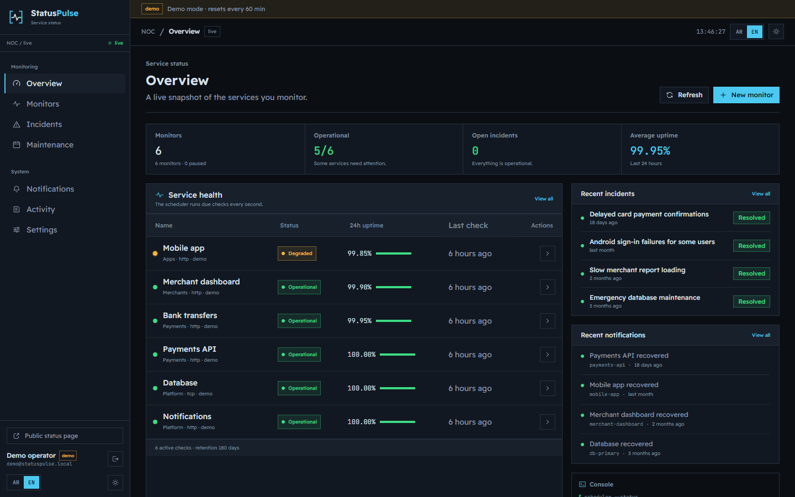
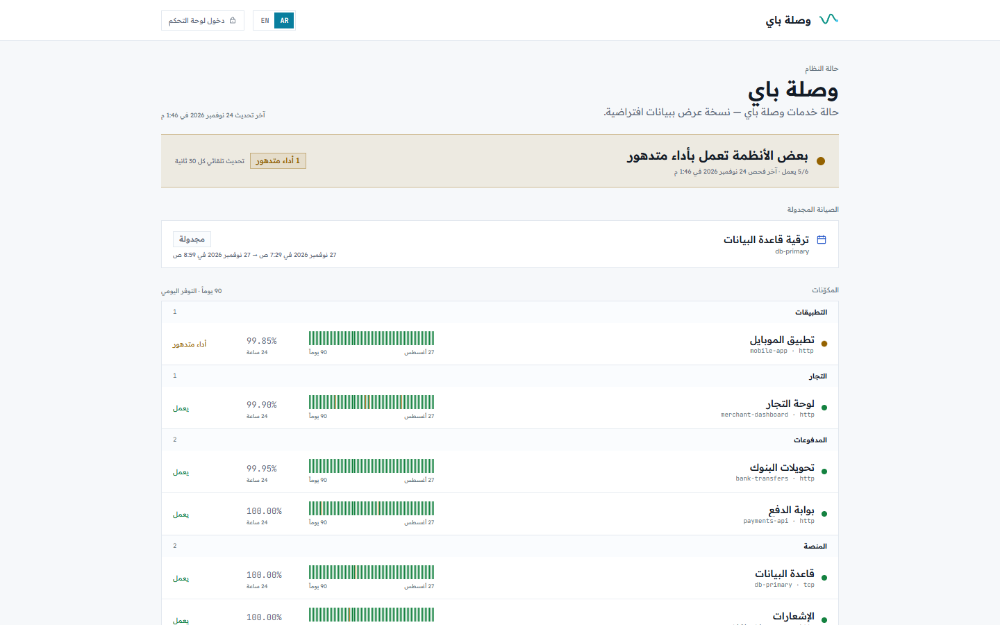
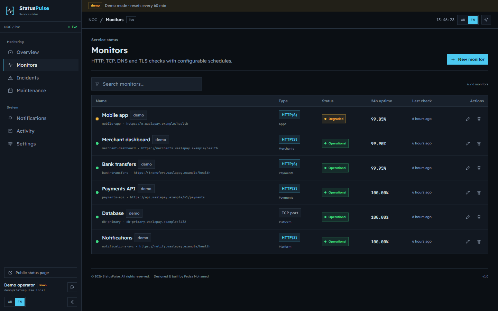
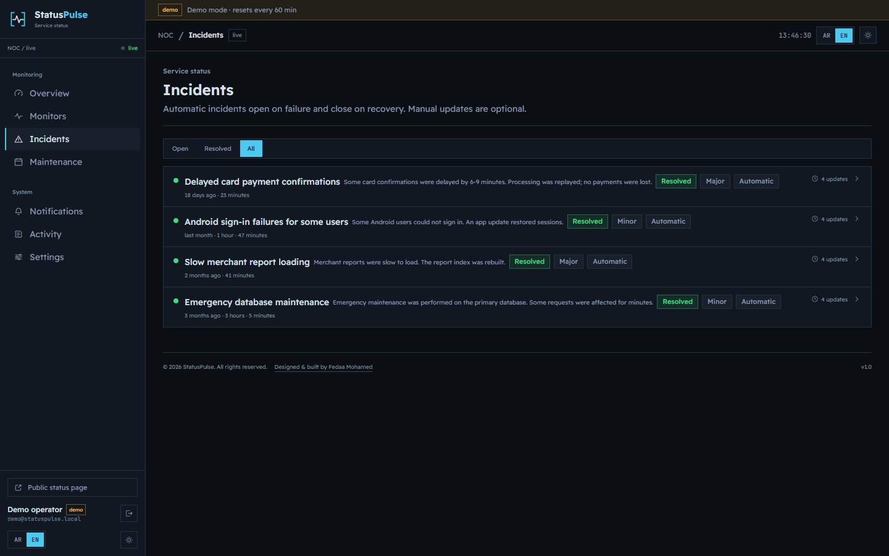
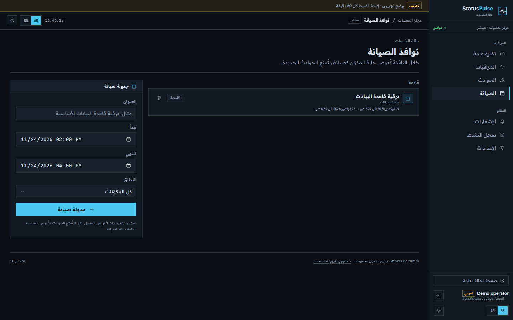
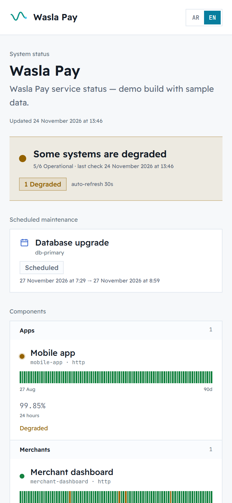
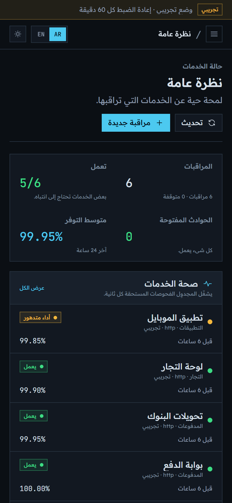
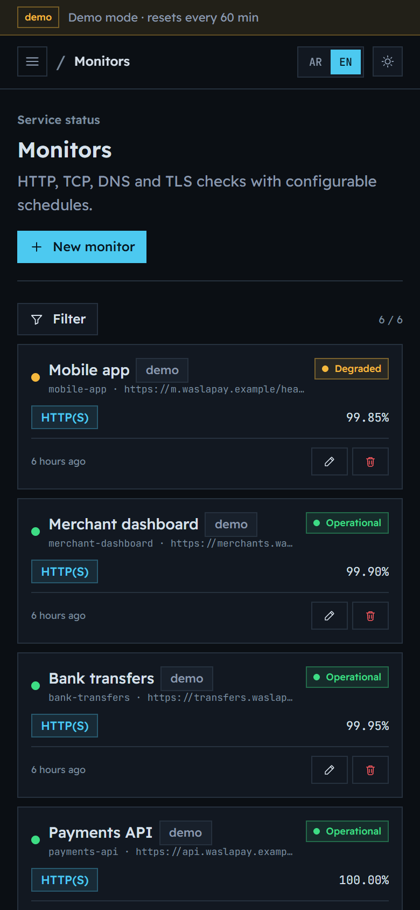

# StatusPulse

Uptime monitoring with automatic incidents and a bilingual public status page.



StatusPulse checks HTTP endpoints, TCP ports, DNS records and TLS certificates on a schedule. Failures open incidents automatically, recoveries close them, and a public status page shows a calm, timestamped view to customers.

The demo is the status page of **Wasla Pay**, a fictional payments company, with 90 days of synthetic checks and incident history.

The interface is Arabic-first (right-to-left) with a complete English version.

## Highlights

- **Monitors:** HTTP(S) with status, keyword and latency rules, TCP ports, DNS (A / AAAA / CNAME / TXT / MX) and TLS expiry and trust.
- **Scheduler and incidents:** one-second tick, retries inside each check, automatic open and close, manual updates and maintenance windows.
- **Operations console:** live readings, component board, latency charts, 90-day bars, CSV export and activity log.
- **Public status page:** grouped components, overall state, active incidents, history and scheduled maintenance, refreshed every 30 seconds.
- **SSRF protection:** private, loopback, link-local and metadata targets are rejected, and the validated IP is pinned for the connection.
- **Security:** session-bound CSRF, throttled sign-in, single-use password reset links and a strict CSP without `unsafe-inline`.

## Screenshots

**Public status page** · Arabic



**Monitors** · English



**Incidents** · English



**Maintenance windows** · Arabic



**On mobile** (English and Arabic)

<p>
  
  
  
</p>

## Tech stack

| Layer | Technology |
| --- | --- |
| Server | Node.js 24, TypeScript (strict), Hono 4 |
| Data | SQLite via better-sqlite3 |
| Frontend | React 19, Vite 7, Tailwind CSS 3, hand-drawn SVG charts |
| Fonts | Readex Pro and JetBrains Mono, self-hosted |
| Tests | Vitest |

No CDNs, trackers or analytics. All fonts and assets are self-hosted.

## Running locally

Requirements: Node.js 24 and npm.

```bash
npm install
npm run build
npm start
```

Then open http://localhost:8106 (console at `/login`).

Full setup notes are in [INSTALL.md](INSTALL.md).

## Demo access

The sign-in page has a one-click guest entry with clearly labelled synthetic data. The shared dataset resets every hour (`npm run demo:reset`). Set `DEMO_MODE=false` to remove the guest entry. To create a real operator account: `npm run create-admin -- --email you@example.com --password "<strong password>"`.

All names, phone numbers, emails and records in the demo are fictional sample data.

## Tests

```bash
npm test
```

181 automated tests, all passing at the time of publishing. Details in [TESTING.md](TESTING.md).

## Documentation

- [INSTALL.md](INSTALL.md)
- [TESTING.md](TESTING.md)
- [SECURITY.md](SECURITY.md)
- [ROADMAP.md](ROADMAP.md)
- [docs/ARCHITECTURE.md](docs/ARCHITECTURE.md)
- [docs/DECISIONS.md](docs/DECISIONS.md)
- [THIRD-PARTY-NOTICES.md](THIRD-PARTY-NOTICES.md)

## License

Copyright © 2026 Fedaa Mohamed. All rights reserved.

This repository is public so the code can be reviewed. It is **not open source**: no permission is granted to use, copy, modify, distribute or sell any part of it without prior written permission. See [LICENSE](LICENSE). Third-party libraries and fonts keep their own licences, listed in [THIRD-PARTY-NOTICES.md](THIRD-PARTY-NOTICES.md).

---

Designed & built by [Fedaa Mohamed](https://fedaamohamed.com).
